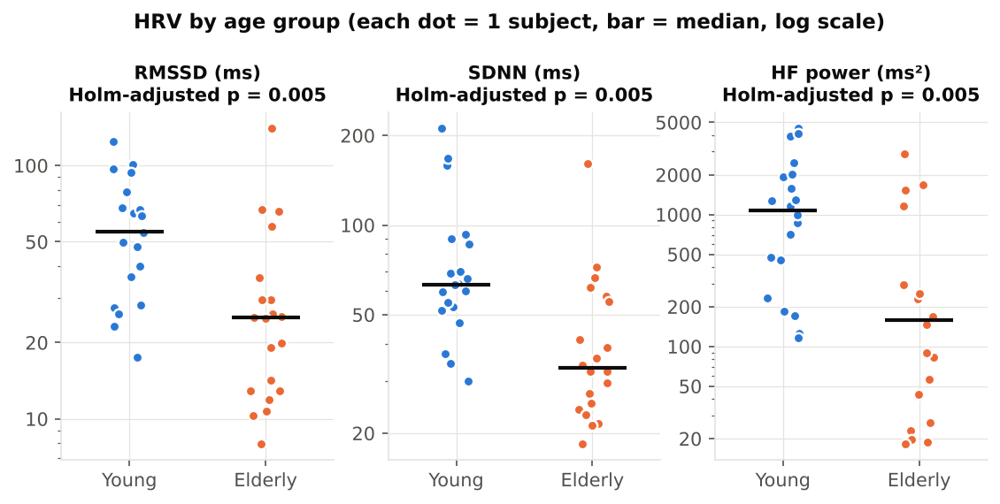
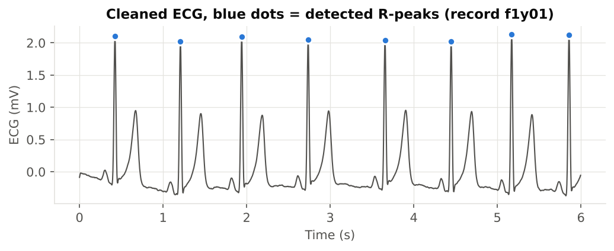
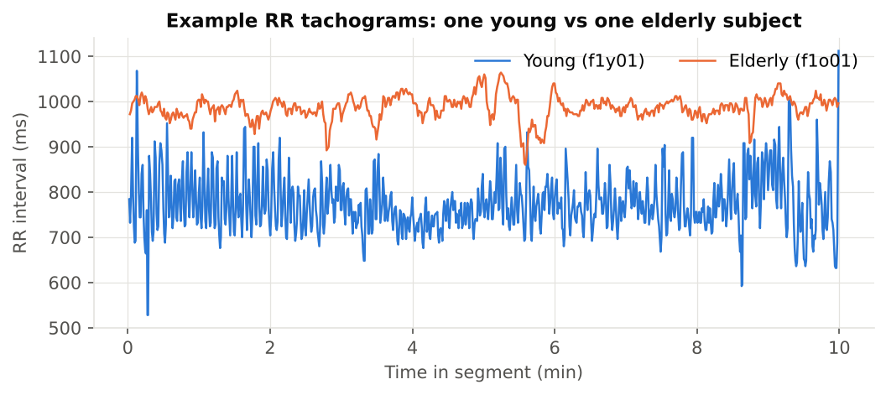

# Batch ECG → HRV pipeline: 40 subjects, young vs elderly

> **Sample project.** Built on free, public PhysioNet data to demonstrate my workflow. This is **not client work.**

## The question
Given a folder of raw ECG recordings, can one script reliably produce RR intervals and HRV for every subject, flag bad recordings, and answer a group question? The test case: **is heart-rate variability lower in elderly than in young healthy adults?** The literature says yes, so the pipeline should reproduce that.

## Data
[PhysioNet Fantasia database](https://physionet.org/content/fantasia/1.0.0/): 20 young (21–34 y) and 20 elderly (68–85 y) healthy subjects, supine rest while watching *Fantasia*, ECG at 250 Hz. I analysed a 10-minute segment per subject (minutes 5–15, skipping the settling period).

## Method
1. **Clean:** NeuroKit2 default ECG filter (high-pass 0.5 Hz + powerline removal).
2. **Detect R-peaks** with artifact correction (Lipponen & Tarvainen 2019).
3. **Quality control:** mean NeuroKit2 quality score per record (flag < 0.5), plus the share of *ectopic-like* beats (successive RR change > 20%).
4. **HRV:** time domain (MeanNN, SDNN, RMSSD, pNN50) and frequency domain (LF, HF, LF/HF).
5. **Stats:** Mann-Whitney U (two-sided), Holm correction across 7 metrics, rank-biserial effect size.
6. **Sensitivity analysis:** repeat the comparison without records that have > 5% ectopic-like beats.

## Results
- **All 40 recordings passed quality control** (quality 0.71–0.98).
- HRV was markedly lower in the elderly group, with heart rate itself not significantly different:

| Metric | Young (median) | Elderly (median) | Holm p | Effect size r |
|---|---|---|---|---|
| Mean HR (bpm) | 62.0 | 58.4 | 0.44 | 0.23 |
| SDNN (ms) | 63.2 | 33.1 | 0.005 | 0.61 |
| RMSSD (ms) | 54.7 | 25.0 | 0.005 | 0.58 |
| pNN50 (%) | 26.6 | 2.3 | < 0.001 | 0.73 |
| HF power (ms²) | 1077 | 158 | 0.005 | 0.60 |
| LF/HF | 1.37 | 2.35 | 0.44 | 0.16 |

- **One elderly outlier (f1o09, RMSSD 141 ms)** had 7.2% ectopic-like beats. High "variability" from premature beats isn't vagal HRV, so it inflates RMSSD. Dropping it and one young record above 5% **strengthens** every result (e.g. SDNN p = 0.002). The conclusion is robust.





## What a client gets from this workflow
- `output/rr_intervals/*.csv`: one RR-interval file per recording
- `output/hrv_per_subject.csv`: HRV + quality + ectopic share per recording
- `output/group_comparison.csv` and `group_comparison_sensitivity.csv`: statistics
- `output/figures/`: ready-to-use figures
- `pipeline.py`: one command reruns everything

## Limitations
10-minute segments only. The ectopic flag is a heuristic, not beat classification. Two subgroups with a small n. LF/HF is reported for completeness but is not a clean "sympathovagal balance" index.

## Run it
```bash
pip install neurokit2 wfdb matplotlib pandas scipy
python pipeline.py      # streams data from PhysioNet on first run, then caches it
```

**References:** Iyengar N. et al. (1996) *Am J Physiol* 271:R1078. Goldberger A. et al. (2000) PhysioBank, PhysioToolkit and PhysioNet, *Circulation* 101:e215. Makowski D. et al. (2021) NeuroKit2, *Behav Res Methods* 53:1689.
