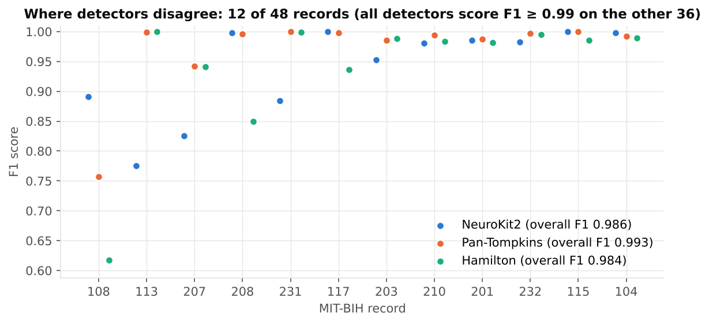

# Does the R-peak detector actually work? Benchmark vs cardiologist annotations

> **Sample project.** Built on free, public PhysioNet data to demonstrate my workflow. This is **not client work.**

## Why this matters
Every HRV number depends on finding every heartbeat. One missed beat creates a fake ~2-second RR interval and inflates SDNN. One extra "beat" on a tall T-wave splits an RR interval in two. Before reporting HRV on anyone's data, check the detector against ground truth.

## Data
[PhysioNet MIT-BIH Arrhythmia Database](https://physionet.org/content/mitdb/1.0.0/): 48 half-hour two-lead ambulatory ECGs at 360 Hz, with every beat labelled by two cardiologists. **109,494 reference beats** in total (non-beat annotations excluded). Lead 1 (usually MLII) was analysed.

## Method
- Three open-source detectors in NeuroKit2, each with its own matching preprocessing: **NeuroKit2** (default), **Pan-Tompkins (1985)** and **Hamilton (2002)**.
- A detection counts as correct if it falls within **±150 ms** of a reference beat (one-to-one matching, the ANSI/AAMI EC57 convention).
- Metrics: sensitivity Se = TP/(TP+FN), positive predictive value PPV = TP/(TP+FP), and F1.

## Results

| Detector | Missed beats (FN) | False beats (FP) | Se | PPV | F1 |
|---|---|---|---|---|---|
| NeuroKit2 | 1,240 | 1,899 | 98.87% | 98.28% | 0.986 |
| **Pan-Tompkins** | **636** | **949** | **99.42%** | **99.14%** | **0.993** |
| Hamilton | 1,927 | 1,461 | 98.24% | 98.66% | 0.984 |

- On **36 of 48 records, all three detectors score F1 ≥ 0.99.** The differences are concentrated in 12 hard records:



- **Each detector fails on different records,** and the failures line up with what the database notes say about those records:
  - **108** (Pan-Tompkins F1 0.76, Hamilton 0.62): multiform PVCs, and the notes describe "considerable noise and baseline shifts" in the lower channel.
  - **113** (NeuroKit2 F1 0.78): 1,039 extra detections on 1,795 beats, i.e. systematic over-detection on this record's morphology. The other two detectors are near-perfect here.
  - **207** (NeuroKit2 F1 0.83, 520 missed beats): "an extremely difficult record" with ventricular flutter, bundle branch blocks and multiform PVCs.
  - **208** (Hamilton F1 0.85, 771 missed beats): frequent PVC couplets with fusion beats.
  - **231** (NeuroKit2 F1 0.88, 410 extra detections): 2:1 AV block and Mobitz II periods. Over-detection here is consistent with non-conducted P-waves being picked up. To confirm, I'd inspect the flagged segments.

## Takeaways for a real project
1. **No detector is best everywhere.** The NeuroKit2 default used in many tutorials came second overall on arrhythmic data.
2. **Validate on a labelled subset of your own data** before running the full study. Even 10–20 hand-checked minutes catches the failure modes above.
3. **Flag, don't hide:** report per-recording detection quality next to the HRV results, so reviewers can see what was excluded.
4. In my HRV sample project (healthy Fantasia subjects) the NeuroKit2 detector is appropriate. For arrhythmia-heavy data I would switch to Pan-Tompkins or run several detectors and review where they disagree.

## Outputs
- `output/summary.csv`: overall Se, PPV and F1 per detector
- `output/per_record.csv`: TP, FN, FP, Se, PPV for every record × detector
- `output/hardest_records.csv`: worst record/detector pairs
- `output/f1_hard_records.png`: figure

## Run it
```bash
pip install neurokit2 wfdb matplotlib pandas
python validate.py                                 # streams from PhysioNet (slow)
MITDB_DIR=/path/to/local/mitdb python validate.py  # or point at a downloaded copy
```

**References:** Moody G.B. & Mark R.G. (2001) The impact of the MIT-BIH Arrhythmia Database, *IEEE Eng Med Biol* 20(3):45–50. Pan J. & Tompkins W.J. (1985) *IEEE Trans Biomed Eng* 32(3):230–236. Hamilton P. (2002) *Computers in Cardiology* 29:101–104. Makowski D. et al. (2021) NeuroKit2, *Behav Res Methods* 53:1689. Goldberger A. et al. (2000) *Circulation* 101:e215.
